<div align="center">

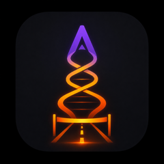

# FitBud

### A running coach that lives on your wrist, not your phone.

[](.)
[](.)
[](.)
[](.)

Built to get one runner from an inconsistent 11 km/week to a half marathon —
**27 September 2026** — without a phone in a pocket or an earbud required.

</div>

---

## What it actually is

FitBud is a **watch-only** SwiftUI app: no iPhone companion, no app to unlock,
nothing to carry. Start a run from your wrist and three things happen at once —

1. **HealthKit records the real workout** — `HKWorkoutSession` +
   `HKLiveWorkoutBuilder`, splits, heart rate, energy, the works.
2. **A heart-rate-zone dial tells you the truth in real time** — not pace, not
   a wall of numbers. One glance says *too hot, ease off* or *right there,
   keep going.*
3. **An AI coach watches the run and says something when it matters** — spoken
   through your headphones, shown beneath the dial, never a guess.

It was built for one specific, unglamorous problem: every run in this
runner's training history sat in the wrong heart-rate zone. Half marathon
training lives or dies on **not** running hard on easy days — the hardest
discipline in the sport is holding back. FitBud's whole design points at that
one problem.

---

## A run, screen by screen

<table>
<tr>
<td width="33%" align="center">
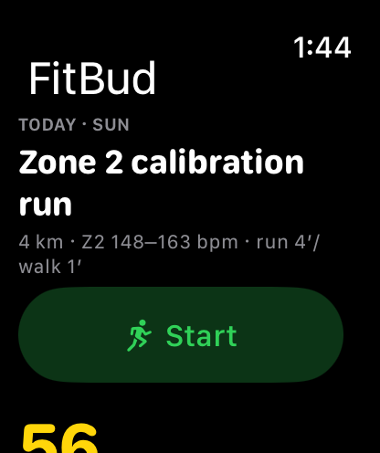<br/>
<b>1 · Today's session</b><br/>
<sub>Pulled straight from an 8-week plan generated from real Apple Health history — not a template.</sub>
</td>
<td width="33%" align="center">
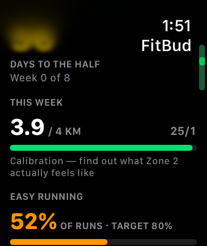<br/>
<b>2 · The countdown that matters</b><br/>
<sub>Days to the half, this week's volume against plan, and why today's session exists.</sub>
</td>
<td width="33%" align="center">
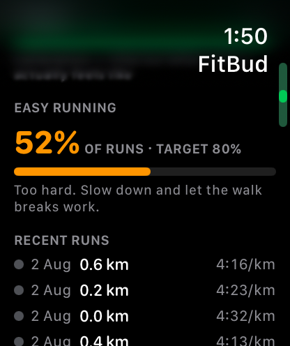<br/>
<b>3 · The one number that mattered</b><br/>
<sub>% of runs that were actually easy vs. the 80% target — the metric the whole plan is built around.</sub>
</td>
</tr>
<tr>
<td width="33%" align="center">
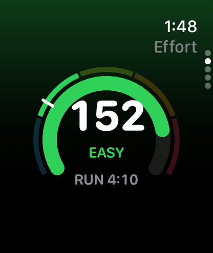<br/>
<b>4 · The dial, calm</b><br/>
<sub>A tachometer, not a chart: heart rate, live zone, and the run/walk interval draining around it.</sub>
</td>
<td width="33%" align="center">
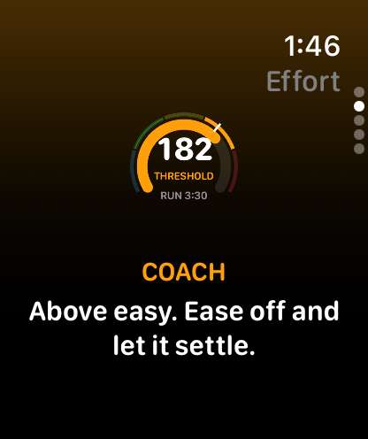<br/>
<b>5 · The dial, talking</b><br/>
<sub>Drift into Z4 and the coach says so — beneath the dial, never covering it. Safety signal stays visible.</sub>
</td>
<td width="33%" align="center">
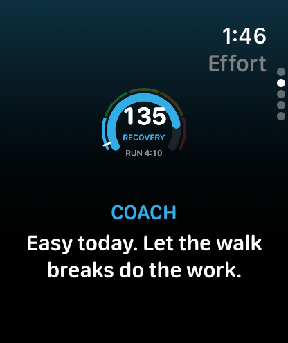<br/>
<b>6 · The dial, encouraging</b><br/>
<sub>Walk breaks get their own tone. This one's scripted per run — never the same line twice.</sub>
</td>
</tr>
<tr>
<td width="33%" align="center">
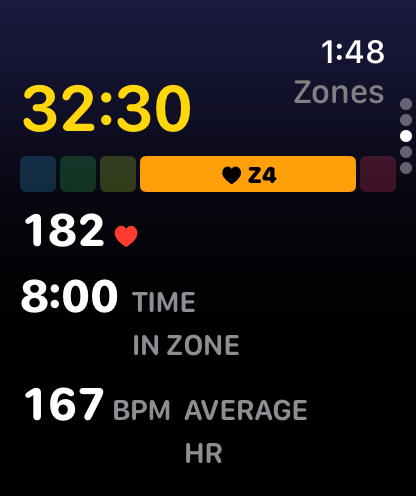<br/>
<b>7 · Zones</b><br/>
<sub>Crown-scroll sideways for a live time-in-zone bar and running average — the receipts, mid-run.</sub>
</td>
<td width="33%" align="center">
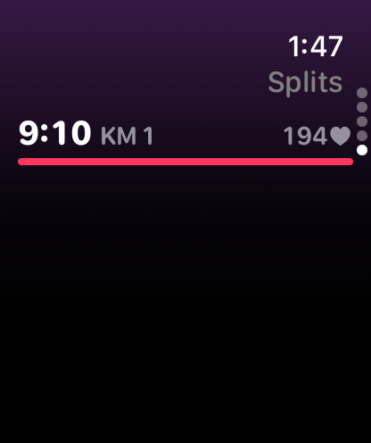<br/>
<b>8 · Splits</b><br/>
<sub>Per-kilometre pace as it happens, colour-tied to the zone it was run in.</sub>
</td>
<td width="33%" align="center">
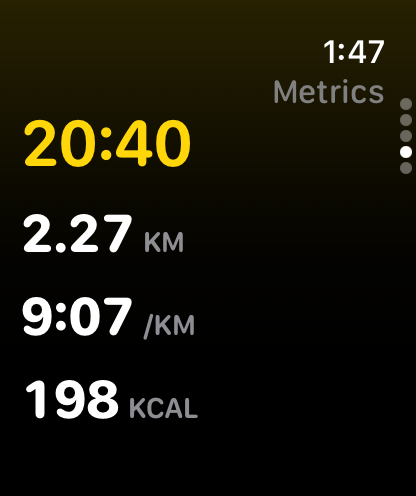<br/>
<b>9 · Metrics</b><br/>
<sub>The plain numbers, for when that's all you want: time, distance, pace, energy.</sub>
</td>
</tr>
<tr>
<td width="33%" align="center">
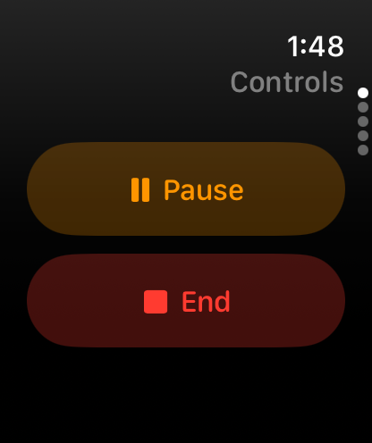<br/>
<b>10 · Controls</b><br/>
<sub>Pause, resume, end — one crown-scroll away from the dial, never accidentally in reach.</sub>
</td>
<td width="33%" align="center">
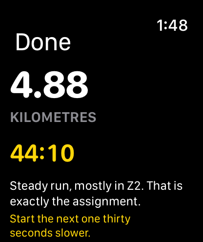<br/>
<b>11 · The debrief</b><br/>
<sub>An AI-written read on the run — specific, not generic — plus what to try differently next time.</sub>
</td>
<td width="33%" align="center">
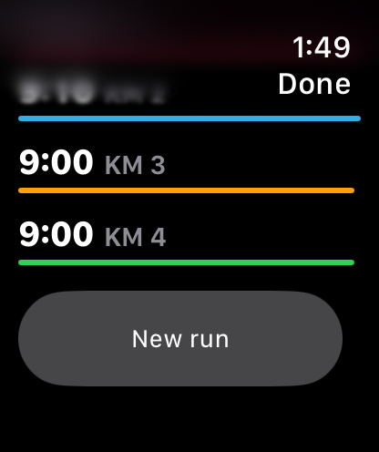<br/>
<b>12 · The proof</b><br/>
<sub>Zone-coloured splits, kilometre by kilometre — did the run match the assignment?</sub>
</td>
</tr>
</table>

---

## The interesting part: coaching with no phone and a flaky radio

An LLM cannot sit in the loop *during* a run. A watch's cellular/Bluetooth
radio is unreliable mid-stride, and a round-trip to an API takes seconds a
struggling runner doesn't have. So FitBud never asks a model anything while
you're running. Instead:

```
BEFORE the run                          DURING the run (zero network)
───────────────────                     ─────────────────────────────
Athlete's plan, recent history,    →    Local CoachEngine matches live
recovery data, today's session          HR / pace / zone / splits
          │                             against those rules, on-device,
          ▼                             every tick.
   LLM writes a SessionBrief:
   an opening line + a small set              │
   of CUE RULES ("if Z4 for 45s,               ▼
   say ease off"; "if pace fades       Cue fires → shown beneath the
   after 1 km, encourage")             dial, spoken through headphones,
                                        a distinct haptic — never a guess,
                                        never a network stall mid-stride.
```

The model gets **proposal rights, never write access** — it drafts the
coaching plan before the gun goes off; a small, fully-tested, pure-Swift
engine is the only thing making decisions while your heart rate is 180 and
the trail has no signal. One live network call is allowed, opportunistically,
during a walk break — the one moment an athlete is actually resting and a
few hundred milliseconds cost nothing.

After the run, the model gets one more turn: a short, specific read on what
actually happened, using the same splits and zone data you just saw on the
watch.

---

## Under the hood

| | |
|---|---|
| **Platform** | watchOS-only SwiftUI, `WKWatchOnly`, no iOS companion |
| **Recording** | `HKWorkoutSession` + `HKLiveWorkoutBuilder` behind a `WorkoutRecording` protocol |
| **Engine** | Pure Foundation — no SwiftUI import — emits typed `WorkoutEvent`s off live samples |
| **AI provider** | `gpt-5-mini`, structured JSON-schema output for the pre-run brief, swappable behind an `AIProviding` protocol (Gemini is a second conformance away) |
| **Coaching logic** | Rule-based, rate-limited, on-device — the network is never on the critical path |
| **Speech** | `AVSpeechSynthesizer`, headphone-gated — the watch speaker never shouts coaching into wind |
| **Testing** | [Swift Testing](https://developer.apple.com/documentation/testing) exclusively — 193 tests, `@Test`/`#expect` |
| **Training plan** | 8 weeks, generated from a real Apple Health export — sleep gates, recovery gates, a hard-capped long run, an immutable cutback week |

**Five live pages, one crown-scroll apart:** Effort (default) · Controls ·
Zones · Metrics · Splits — each its own `NavigationStack`, so the app can
never strand you on a stale screen mid-run.

---

## Building it

```bash
git clone https://github.com/Manan27jain/FitBud.git
cd FitBud
open FitBud.xcodeproj
```

Run the **FitBud Watch App** scheme on any watchOS 11.2+ simulator or a
paired device. AI coaching is optional — without a key, the app falls back
to a curated default cue bundle and runs fully offline. To enable it, copy
`FitBud Watch App/Resources/Secrets.example.plist` to `Secrets.plist` in the
same folder and drop in an OpenAI key (gitignored, never leaves your
machine).

A **Demo run (scripted HR)** button on the home screen (debug builds only)
drives a scripted 130→200 bpm heart-rate sweep at 20× speed — every zone,
every coaching trigger, in about a minute, with zero real movement required.

### Testing

```bash
xcodebuild -project FitBud.xcodeproj -scheme "FitBud Watch App" \
  -destination "platform=watchOS Simulator,name=Apple Watch Series 10 (46mm)" \
  test
```

---

<div align="center">
<sub>A personal project, built one training block at a time.</sub>
</div>
